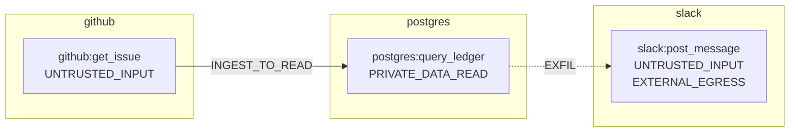

# mcpprobe (Latch) — Deterministic MCP & Agentic Protocol Security Verifier

**`mcpprobe`** is the project, Python package and CLI name; **`(Latch)`** is its
subtitle. `mcpprobe (Latch)` is a deterministic security verifier for
[Model Context Protocol](https://modelcontextprotocol.io) servers and the agents
that mount them. Six engines, no LLM in the loop:

> **Name disambiguation.** This repository is **`mcpprobe`**, subtitle
> **`Latch`**, CLI `mcpprobe` (alias `latch`). It is *not*:
> - **`AgentLatch`** (`AgentLatch/agent-latch`): a local-first Python AST
>   scanner plus a passive, monitor-only MCP proxy. Different tool, different
>   author, different approach (it reads agent *source code*, not MCP schemas).
> - **`Invariant / Snyk mcp-scan`** (`github.com/snyk/agent-scan`, formerly
>   `invariantlabs-ai/mcp-scan`): a CLI scanner with tool pinning and a
>   monitoring proxy that calls the Snyk/Invariant Guardrails API for deep
>   prompt-injection classification. `mcpprobe` compares itself against it
>   empirically in [`head_to_head/`](head_to_head/HEAD_TO_HEAD.md).
> - Unrelated `latch` packages on PyPI/npm (build tooling, hardware buttons):
>   no shared code, no shared authors.
>
> The overlapping word is "latch", not the codebase. The scored comparison and
> capability matrix live in
> [`head_to_head/HEAD_TO_HEAD.md`](head_to_head/HEAD_TO_HEAD.md).

| Engine | Question it answers | Commands |
| ------ | ------------------- | -------- |
| **Deterministic schema pinning** | "Is the tool surface I approved still the tool surface I am running?" | `pin`, `verify`, `watch` |
| **Protocol hygiene auditor** | "Does this manifest carry hidden instructions, spoofing or unsafe header bindings?" | `audit` |
| **Lethal-trifecta capability graph** | "Can one agent combine untrusted input, private data and external egress?" | `graph` |
| **Cross-server shadowing detector** | "Is another server impersonating a trusted tool, or steering the model away from it?" | `shadow`, `graph --check-shadow` |
| **OAuth authorization auditor** | "Are credentials reused, hardcoded, cleartext or passed through as tool arguments?" | `auth-audit` |
| **Execution-aware chain prober** | "Does a static trifecta chain actually exfiltrate when the tools run?" | `probe-chain` |

Latch captures a server's `tools/list` response, pins every tool definition into
a reviewable lockfile with a SHA-256 digest, and later proves that the live tool
surface still matches what you reviewed. Any added, removed or edited tool fails
verification — including a single invisible Unicode character sneaked into a
tool description. Every finding is emitted as stable JSON and as SARIF 2.1.0, so
the same check runs on a laptop and in CI.

## Install

```bash
python -m venv .venv
.venv/bin/pip install -e ".[dev]"
```

`pydantic`, `click` and `httpx` are the only runtime dependencies; `pytest`
lives in the `dev` extra and the optional `peer` extra installs
`snyk-agent-scan` (the `mcp-scan` distribution) for the measured comparison in
[`head_to_head/`](head_to_head/HEAD_TO_HEAD.md).

Both console names — `mcpprobe` and `latch` — invoke the same entrypoint.

## Quickstart

```bash
# Pin the approved surface, then prove it later (drift + hygiene in one pass).
latch pin    --stdio "npx -y @modelcontextprotocol/server-github" --server-id github --output latch.lock.json
latch verify --stdio "npx -y @modelcontextprotocol/server-github" --lockfile latch.lock.json --audit

# Watch a live session for a mid-flight rug pull.
latch watch  --stdio "npx -y @modelcontextprotocol/server-github" --lockfile latch.lock.json --duration 60

# Audit a captured manifest and draw the capability graph.
latch audit  --input tools-list.json --fail-on HIGH
latch graph  --config .cursor/mcp.json --format mermaid

# Catch tool-name impersonation and cross-tool routing hijacks.
latch shadow --config .cursor/mcp.json --trust-server github
latch graph  --config .cursor/mcp.json --check-shadow

# Audit OAuth credentials, audience binding and RFC 9728 metadata.
latch auth-audit --config .cursor/mcp.json --live --sarif auth.sarif

# Inspect the exact read/egress arguments without executing anything.
latch probe-chain --config .cursor/mcp.json --dry-run

# Write SARIF 2.1.0 for GitHub code scanning (exit codes unchanged).
latch graph  --config .cursor/mcp.json --sarif latch.sarif
```

## Usage

Capture the server's tool list and pin it:

```bash
mcpprobe pin --input tools-list.json --server-id github-mcp --output mcpprobe.lock.json
```

Commit `mcpprobe.lock.json` alongside your config. Later, re-capture and verify:

```bash
mcpprobe verify --input tools-list.json --lockfile mcpprobe.lock.json
mcpprobe verify --input tools-list.json --lockfile mcpprobe.lock.json --json
```

Both raw manifests (`{"tools": [...]}`) and full JSON-RPC envelopes are
accepted:

```json
{
  "jsonrpc": "2.0",
  "id": 1,
  "result": {"tools": [{"name": "echo", "description": "Echo text back."}], "ttlMs": 60000}
}
```

### Harvesting a live MCP server

`pin`, `verify`, and `audit` accept a live target instead of a captured file:

```bash
latch pin --stdio "npx -y @modelcontextprotocol/server-github" --server-id github --output latch.lock.json
latch verify --url https://mcp.example.com/mcp --header "Authorization: Bearer $TOKEN" --lockfile latch.lock.json
latch audit --stdio "python -m my_mcp_server"
```

Exactly one of `--input`, `--stdio`, or `--url` is required — passing none or
several exits `2`. `--header "Name: Value"` is repeatable and `--timeout`
defaults to 10 seconds.

Negotiation starts with MCP `2026-07-28` `server/discover` (protocol version and
client info in `params._meta`). If the server answers JSON-RPC `-32601` or HTTP
`400`/`404`, Latch automatically falls back to the `2025-11-25` `initialize`
handshake, keeps any `Mcp-Session-Id` it is issued, and sends
`notifications/initialized`. `tools/list` then follows `nextCursor` until the
server stops returning one, aggregating every page into a single snapshot.

### Watching for a mid-session rug pull

```bash
latch watch --stdio "npx -y some-mcp-server" --lockfile latch.lock.json --duration 60 --audit
latch watch --url https://mcp.example.com/mcp --header "Authorization: Bearer $TOKEN" --json
```

`watch` keeps one session open and waits for
`notifications/tools/list_changed`. Every mutation immediately re-runs
field-level differential verification — and the protocol audit with `--audit` —
against the pin, and prints exactly what changed. Without `--lockfile`, the
initial snapshot becomes an in-memory baseline. Exit `1` on a rug pull (or an
audit failure), `0` when clean, `2` on transport or protocol errors.

Over Streamable HTTP, change notification is delivered through
`subscriptions/listen` SSE; a server that does not implement push subscriptions
produces an explicit error rather than a silent no-op.

### Field-level drift explanations

`MODIFIED_TOOL` reports carry a severity and per-field changes, so a rug pull is
explained rather than just flagged:

```text
  ~ MODIFIED_TOOL echo [HIGH]
      expected sha256 8f1c…
      actual   sha256 2b7a…
      MODIFIED description [HIGH]
          "Echo text back." -> "Echo text back!\u200b"
          reason: Tool description modified after approval (tool poisoning: instructions the model trusts changed)
```

| Severity | Meaning |
| -------- | ------- |
| `CRITICAL` | `x-mcp-header` binding added/modified, or Unicode concealment characters introduced. |
| `HIGH` | Tool/parameter `description` modified, parameter added, `required` relaxed, safety hint flipped (`readOnlyHint` true→false, `destructiveHint`/`openWorldHint` false→true). `ADDED_TOOL` defaults here (or `CRITICAL` if the new tool audits critical). |
| `MEDIUM` | `outputSchema`, parameter constraints (`type`, `enum`, `pattern`), other annotations, or extension fields (`_meta`) changed. `REMOVED_TOOL` reports at `LOW`. |
| `LOW` | Display-only `title` / `icons` changed. |

## Static metadata & protocol audit

`mcpprobe audit` never contacts the server. It walks every string in the
manifest and applies fixed rules:

```bash
mcpprobe audit --input tools-list.json
mcpprobe audit --input tools-list.json --fail-on CRITICAL --json
mcpprobe verify --input tools-list.json --lockfile mcpprobe.lock.json --audit
```

| Rule | Severity | Detects |
| ---- | -------- | ------- |
| `UNICODE_TAG_BLOCK` | CRITICAL | Codepoints `U+E0000`–`U+E007F`; the hidden ASCII payload is decoded into `evidence`. |
| `UNICODE_BIDI_OVERRIDE` | HIGH | `U+202A`–`U+202E`, `U+2066`–`U+2069`, `U+200E`, `U+200F`, `U+061C`. |
| `UNICODE_ZERO_WIDTH` | MEDIUM | `U+200B`, `U+200C`, `U+200D`, `U+2060`, `U+FEFF`. |
| `UNICODE_VARIATION_SELECTOR` | HIGH | `U+FE00`–`U+FE0F` and `U+E0100`–`U+E01EF` variation selectors, which can pick an invisible alternate glyph. |
| `HEADER_PRIVILEGED_INJECTION` | CRITICAL | `x-mcp-header` bound to `Authorization`, `Cookie`, `Host`, `X-API-Key`, `X-Forwarded-For` and friends. |
| `HEADER_CRLF_CONTROL` | CRITICAL | CR/LF/NUL or any ASCII control character in an `x-mcp-header` value. |
| `HEADER_SPEC_VIOLATION` | HIGH | Non-string/empty header name, duplicate case-insensitive header name, or a parameter type other than `string`/`integer`/`boolean`. |
| `TOOL_NAME_SPEC_VIOLATION` | MEDIUM | Names outside `^[A-Za-z0-9_.-]{1,128}$`. |
| `ANNOTATION_CONTRADICTION` | MEDIUM | `readOnlyHint: true` with `destructiveHint: true` or with `x-mcp-header` bindings. |

`--fail-on` defaults to `MEDIUM`: the audit passes only when no finding is at or
above that severity (`CRITICAL > HIGH > MEDIUM > LOW`).

### Exit codes

| Code | Meaning |
| ---- | ------- |
| `0`  | Verification passed — no drift. |
| `1`  | Drift detected: `ADDED_TOOL`, `REMOVED_TOOL` or `MODIFIED_TOOL`. |
| `2`  | Invalid input: bad JSON, missing file, malformed MCP tool schema. |

`--json` emits a structured report:

```json
{
  "actual_manifest_sha256": "…",
  "drift": [
    {"actual_sha256": "…", "expected_sha256": "…", "kind": "MODIFIED_TOOL", "tool_name": "echo"}
  ],
  "expected_manifest_sha256": "…",
  "passed": false,
  "schema_version": "1.0",
  "server_id": "github-mcp"
}
```

## Capability graph & lethal-trifecta analysis

`latch graph` ingests a multi-server agent configuration and looks for the
exfiltration pattern that matters: **untrusted input → private data read →
external egress** inside one agent's blast radius.

```bash
latch graph --config ~/Library/Application\ Support/Claude/claude_desktop_config.json
latch graph --config .vscode/mcp.json --live --format mermaid
latch graph --server-manifest github=gh.json --server-manifest db=pg.json --server-manifest slack=sl.json
latch graph --config .cursor/mcp.json --trust-server local-db --warn-only
```

Accepted configs: Claude Desktop / Cursor / Windsurf (`mcpServers`), VS Code
(`servers`), and Latch bundles where an entry carries `{"tools": [...]}`. An
entry with `command` is a stdio server and one with `url` is Streamable HTTP;
those are only harvested with `--live`, otherwise Latch exits `2` telling you to
pass `--live` or supply a static snapshot. At least one `--config` or
`--server-manifest` is required.

Each tool is tagged with zero, one, or several capabilities, using annotation
hints, JSON Schema parameter signatures, and **identifier tokenization**
(`readFile` → `read` + `file`) — never substring matching, so `asset_manager`
cannot masquerade as `ssh` access. Enum values on parameter schemas are
classified the same way, so a generic `invoke_connector(action: enum["read",
"upload"])` cannot hide its `upload` capability behind an uninformative name.

| Capability | Signal |
| ---------- | ------ |
| `UNTRUSTED_INPUT` | Ingestion verb (`get`, `read`, `fetch`, `list`, `search` …) with an external content noun (`issue`, `comment`, `email`, `web`, `log` …), or `openWorldHint: true` on a non-destructive tool. |
| `PRIVATE_DATA_READ` | Read/query verb with a sensitive resource token (`file`, `env`, `secret`, `ssh`, `wallet`, `account`, `sql`, `vault` …), or a read-only closed-world tool taking a `path`/`query`/`sql`/`id` parameter. |
| `LOCAL_WRITE` | Mutation verb in the tool name (`write`, `edit`, `commit`, `merge`, `insert`, `create`, `delete` …) with no outbound network, recipient or remote-publishing target: state stays on this machine or in this repository. Reported for visibility, never as an exfil sink. |
| `EXTERNAL_EGRESS` | Outbound verb (`send`, `post`, `upload`, `dispatch`, `relay` …) with an external target (`url`, `endpoint`, `dest`, `sink`, `repo` …), an outbound sink parameter (`webhook_url`, `recipient`, `to` …), an `x-mcp-header` binding, or `openWorldHint: true` without `readOnlyHint`. |

A tool that only mutates local state is `LOCAL_WRITE`, not `EXTERNAL_EGRESS`:
`git_commit`, `git_merge`, `git_create_branch`, `git_checkout`, `git_reset`,
`git_add`, `write_file`, `edit_file`, `move_file`, `create_directory`,
`create_entities` and friends cannot send data anywhere, so they never close a
chain. True sinks — `git_push`, HTTP/webhook senders, email/chat messengers,
public issue/PR creators, uploads with a URL or recipient — stay
`EXTERNAL_EGRESS` and keep their severity.

Every `ingest → read → egress` chain becomes a ranked path, collapsed per
`(ingest, egress)` pair: a server with 15 read tools produces one path that
lists all 15 in `read_tools` (`collapsed_read_count`), not 15 near-duplicate
rows. `read_tool` keeps the first sorted reachable read tool for compatibility.

* `CRITICAL` — spans two or more servers, or the egress tool accepts a
  caller-chosen URL/webhook/recipient (or binds `x-mcp-header`).
* `HIGH` — single server, no caller-controlled destination.

`--trust-server <id>` bars a server from acting as an untrusted source or an
egress sink (a trusted local database is still a legitimate read source). Exit
`1` when any path exists, `0` when clean, `2` on config/manifest errors;
`--warn-only` reports without failing. `--format mermaid` emits a diagram:



Three refinements keep the graph honest. Local state mutations never form a
sink, so `server-filesystem` + `mcp-server-git` reports **zero** CRITICAL paths
instead of 27. A chain is only built when the ingest tool and the egress tool
are different, so a write-only sink such as `slack:post_message` with
`openWorldHint: true` cannot manufacture a degenerate
`post_message → read → post_message` self-loop that no attacker can exploit.
And `ledger`/`ledgers` are sensitive resource tokens, so `read_ledger` and
`get_ledger` classify as `PRIVATE_DATA_READ` without any naming ceremony.

## Execution-aware verification: `probe-chain`

`latch graph` answers "could this chain fire?". It cannot see RBAC, an egress
allowlist, or a tool that simply ignores its arguments, so on a hardened server
a static CRITICAL can be a false positive — the BloodHound problem. `latch
probe-chain` settles it by executing both halves of every static chain.

Because that means real `tools/call` invocations, it refuses to run without
explicit consent and a tool scope, and it can show you the plan instead:

```bash
# Inspect the exact read/egress arguments without executing anything.
latch probe-chain --config .cursor/mcp.json --dry-run

# Execute only the paths you named, after consenting to execution.
latch probe-chain --config .cursor/mcp.json \
  --i-understand-this-executes-tools \
  --allow-tool github:get_issue --allow-tool slack:post_message

# Or allow every tool a static path names (consent is still required).
latch probe-chain --config .cursor/mcp.json \
  --i-understand-this-executes-tools --allow-all-tools

# Send egress to your own capture endpoint instead of the loopback sink.
latch probe-chain --config .cursor/mcp.json \
  --i-understand-this-executes-tools --allow-all-tools \
  --sink-url https://canary.corp.example
```

Without `--i-understand-this-executes-tools` (and without `--dry-run`) the
command exits `2` and prints the consent warning; without `--allow-tool` or
`--allow-all-tools` it exits `2` asking for a scope. `--allow-tool` accepts
`<server>:<tool>` and `<server>:*`, and a path whose read or egress tool is not
matched is reported `SKIPPED_NOT_ALLOWLISTED` and never called.

The prober calls the read tool with benign read-only arguments, then calls the
egress tool with an ephemeral HTTP sink bound to `127.0.0.1:0` inside its own
process, using a fresh `LATCH-CANARY-<16hex>` token. Nothing leaves the machine
and nothing is written: success is proven by the sink receiving the canary, not
by trusting the tool's own reply text. With `--sink-url` the payload goes to
your endpoint instead; Latch cannot read that sink back, so the result is
`UNCONFIRMED_SSRF_GUARD` with the target recorded in `sink_request_summary`.

| Status | Meaning |
| ------ | ------- |
| `CONFIRMED_EXPLOITABLE` | The canary reached the loopback sink: the chain is a real exfiltration path. |
| `BLOCKED_AT_READ` | The read tool refused (RBAC/scope), so no private data entered the context. |
| `BLOCKED_AT_EGRESS` | The egress tool ran but the canary never arrived, and the error names an operator allowlist or validation rule. |
| `UNCONFIRMED_SSRF_GUARD` | The egress tool rejected `127.0.0.1` as an SSRF/private address, or an external sink cannot be read back: internet egress is **unverified**, not blocked. |
| `INCONCLUSIVE_SCHEMA` | The chain cannot be parameterized (no URL/sink or string payload). |
| `DRY_RUN_SKIPPED` | `--dry-run`: the synthesized `read_args`/`egress_args` are returned and nothing was called. |
| `SKIPPED_NOT_ALLOWLISTED` | The path's tools were not matched by `--allow-tool`; nothing was called. |

Exit `1` when a chain is confirmed **or left unconfirmed by an SSRF guard**, and
`0` only when every static path was disproven or skipped. An SSRF-guarded chain
is never reported as safe: SARIF keeps it visible as
`LATCH-CHAIN-UNCONFIRMED-SSRF` at `warning` level. The sink matches the raw
canary, its base64 encodings, and decodes base64 request bodies, so an egress
tool that wraps or relocates the payload is still caught.

## Cross-server tool shadowing & hijacking

Several MCP servers share one flat tool namespace, so a hostile server can
impersonate a trusted tool's name or steer the model away from it. `latch
shadow` reads the same configuration `graph` does:

```bash
latch shadow --config .cursor/mcp.json
latch shadow --config .cursor/mcp.json --trust-server github --format json
latch shadow --config .cursor/mcp.json --sarif shadow.sarif
latch graph  --config .cursor/mcp.json --check-shadow
```

| Rule | Severity | Detects |
| ---- | -------- | ------- |
| `EXACT_TOOL_SHADOW` | CRITICAL / HIGH | Two servers expose the same `tool.name`; CRITICAL when a trusted server is shadowed by an untrusted one. |
| `NORMALIZED_TOOL_SHADOW` | HIGH | Names differing only in casing or separators (`read_file` / `readFile` / `read-file`). |
| `CONFUSABLE_UNICODE_SHADOW` | CRITICAL | NFKC compatibility characters or Cyrillic/Greek homoglyphs (`r\u0435ad_file`) that fold onto another tool's name; evidence lists the exact codepoints. |
| `CROSS_TOOL_HIJACK` | CRITICAL | A description names another server's tool beside a routing directive (`instead`, `first`, `override`, `route`, …). |

Names are folded with NFKC plus a fixed homoglyph map and compared on a
canonical key, so `read_file` and `rеad_file` collide while `read_file` and
`read_file_metadata` do not. Invisible format characters (`U+200B`, `U+200C`,
`U+200D`, `U+FEFF`) and Latin/Armenian lookalikes are folded too, so
`read_<ZWSP>file` collides. Directive words alone are not enough: the text must
also name a tool owned by another server. `--trust-server` bars a server from
being a hijack source and makes shadowing it CRITICAL.

## OAuth 2.1 / RFC 9728 authorization audit

An agent holds every server's credentials at once, which makes confused-deputy
replay the default failure mode. `latch auth-audit` checks the configuration
statically, and with `--live` probes each HTTP server's challenge and RFC 9728
protected-resource metadata:

```bash
latch auth-audit --config .cursor/mcp.json
latch auth-audit --config .cursor/mcp.json --fail-on CRITICAL --format json
latch auth-audit --config .cursor/mcp.json --live --sarif auth.sarif
```

| Rule | Severity | Detects |
| ---- | -------- | ------- |
| `CROSS_SERVER_CREDENTIAL_REUSE` | CRITICAL | Two or more servers send the same credential, literal or the same `${ENV}` reference. |
| `HARDCODED_STATIC_CREDENTIAL` | HIGH | A sensitive header/env value, or a literal `api_key`/`token` in the server URL query string, that is neither an interpolation nor a dummy. |
| `INSECURE_HTTP_AUTH_TRANSPORT` | CRITICAL | A non-loopback `http://` server with credentials configured, or probed live. |
| `TOKEN_PASSTHROUGH_RISK` | HIGH | A non-identity server accepts `access_token`/`refresh_token`/… as a parameter or header binding. |
| `OPEN_UNAUTHENTICATED_REMOTE_MCP` | HIGH | A public HTTP endpoint answers `server/discover` with a 200 result and no auth. |
| `MISSING_WWW_AUTHENTICATE_PRM` | HIGH | A 401 whose `WWW-Authenticate` omits `resource_metadata`. |
| `MISSING_PROTECTED_RESOURCE_METADATA` | MEDIUM | No usable `/.well-known/oauth-protected-resource` document. |
| `PRM_RESOURCE_MISMATCH` | CRITICAL | The advertised `resource` uses a different scheme, host, port or unrelated path. |

Credentials are never echoed: every value is redacted to
`prefix...suffix [sha256:<8hex>]`, so identical shared tokens correlate across
servers and SARIF runs without exposing the secret.

## SARIF 2.1.0 output

`verify`, `audit`, `watch` and `graph` all take `--sarif <path>`. It writes a
SARIF 2.1.0 log *alongside* the normal terminal or `--json` output — never
instead of it — and never changes the exit code (`0`, `1`, `2`).

| Producer | Rule IDs |
| -------- | -------- |
| `verify`, `watch` | `LATCH-DRIFT-ADDED`, `LATCH-DRIFT-REMOVED`, `LATCH-DRIFT-MODIFIED` |
| `audit` | `LATCH-AUDIT-<RULE_ID>` (e.g. `LATCH-AUDIT-UNICODE_TAG_BLOCK`) |
| `graph` | `LATCH-GRAPH-TRIFECTA` |
| `probe-chain` | `LATCH-CHAIN-CONFIRMED`, `LATCH-CHAIN-UNCONFIRMED-SSRF` |

Severity maps to SARIF `level`: `CRITICAL` and `HIGH` → `error`, `MEDIUM` →
`warning`, `LOW` → `note`. Rules carry CWE tags (`CWE-345`, `CWE-74`,
`CWE-116`, `CWE-284`) in `properties.tags`, and `artifactLocation.uri` is the
manifest or config path that was scanned — or `mcp://live-target` for
`--stdio`/`--url` scans. Each result carries a stable `partialFingerprints`
value so code scanning de-duplicates alerts across runs, and `tool.driver`
contains only the rules actually referenced by the log.

```bash
latch verify --input tools-list.json --lockfile latch.lock.json --sarif drift.sarif
latch audit  --input tools-list.json --sarif audit.sarif --json
latch graph  --config .cursor/mcp.json --sarif trifecta.sarif
latch watch  --stdio "npx -y some-mcp-server" --lockfile latch.lock.json --sarif watch.sarif
```

## Benchmark: precision and recall

`benchmark/` is a deterministic ground-truth harness: 36 synthetic fixtures —
18 hostile cases and 18 benign hard lookalikes — spanning every engine, scored
against the naive keyword/substring scanner that Latch replaces — the
`ssh`/`secret`/`token`/`bearer`/`http://`/`instead`/`before`/`x-mcp-header` grep
that YARA-style rules tend to become. No network, no timestamps, no randomness.

```bash
python -m benchmark.run_benchmark
```

| Scanner | TP | FP | TN | FN | Precision | Recall | F1 | FPR |
| ------- | -- | -- | -- | -- | --------- | ------ | -- | --- |
| Naive keyword/substring baseline | 11 | 12 | 6 | 7 | 0.48 | 0.61 | 0.54 | 0.67 |
| **Latch** | 18 | 0 | 18 | 0 | 1.00 | 1.00 | 1.00 | 0.00 |

The baseline misses every attack that avoids a magic word — an annotation flip,
a hidden `bcc` parameter, tag-block and BiDi concealment, a trusted tool being
shadowed, and a Cyrillic homoglyph — and fires on `passhash_verifier`,
`secret_santa_matcher`, a legitimate `X-Correlation-ID` telemetry header, an
`${ENV}` placeholder, an OAuth broker and a loopback dev server. Latch separates
intent from vocabulary by tokenizing identifiers, hashing canonical
definitions, allowlisting header bindings, folding Unicode confusables,
normalizing credentials and analyzing capability chains. Per-case detail,
including which engine fired and which keywords the baseline matched, is in
[`benchmark/RESULTS.md`](benchmark/RESULTS.md); raw numbers are in
[`benchmark/results.json`](benchmark/results.json).

## Evaluation suites: five empirical corpora

Five independent suites keep the engines honest. Every scoring run is offline
and deterministic; only `package_eval.capture_manifests` uses the network, and
only to install the packages it captures.

| # | Suite | Stage | Corpus | Result | Report |
| - | ----- | ----- | ------ | ------ | ------ |
| 1 | `benchmark/` | Post-tuning | 36 synthetic fixtures (18 hostile, 18 benign lookalikes) | Precision `1.00`, FPR `0.00`, recall `1.00` vs. naive `0.48` / `0.67` / `0.61` | [`benchmark/RESULTS.md`](benchmark/RESULTS.md) |
| 2 | `package_eval/` | First-run blind + post-tuning | 14 real npm/PyPI packages (124 tools, pinned pre-patch releases + clean references) and 5 compositions | **First-run blind baseline** (9 packages): in-scope recall `0.67` (2/3), FPR `0.20` (1/5). **Post-tuning corpus** (14 packages): in-scope `0.88` (7/8), overall `0.70` (7/10, including two honest handler-CVE misses), FPR `0.17` (1/6) vs. naive `0.83` (5/6) | [`package_eval/PACKAGE_EVAL_REPORT.md`](package_eval/PACKAGE_EVAL_REPORT.md) |
| 3 | `synthetic_regression/` | Post-tuning | 24 fixtures modeled on disclosed MCP bug classes | `1.00` in-scope recall, `0.83` overall recall with 2 out-of-scope handler bugs | [`synthetic_regression/REGRESSION_REPORT.md`](synthetic_regression/REGRESSION_REPORT.md) |
| 4a | `adversarial/` Wave 1 | Post-tuning | 24 evasion probes, iteratively hardened | `19/19` post-tuning catches + 5 irreducible boundaries | [`adversarial/EVASION_REPORT.md`](adversarial/EVASION_REPORT.md) |
| 4b | `adversarial/` Wave 2 | Author-blind, pre-tuning | 16 self-authored blind probes (12 hostile, 4 benign), no rule edits | **Author-blind upper bound** (awaiting independent external submission): precision `1.00`, recall `0.42`, FPR `0.00` — 5 catches, **7 honest misses** | [`adversarial/WAVE2_BLIND_REPORT.md`](adversarial/WAVE2_BLIND_REPORT.md) |
| 4c | `adversarial/` external kit | No submission yet | Contributor-authored 10-probe schema, no access to the rules | Schema/scorer validated in CI; **no external submission yet**, so nothing is claimed | [`adversarial/EXTERNAL_BLIND_REPORT.md`](adversarial/EXTERNAL_BLIND_REPORT.md) |
| 5 | `head_to_head/` | Post-tuning (+ first-run blind row) | 14 real captures, peer scanner invoked (`snyk-agent-scan` `0.6.11`), 429 daily limit, no verdict (refresh with `--force-refresh`), 10 self-authored scenarios demoted to an appendix | Clean-package FPR `0.17` (1/6) post-tuning vs. `0.20` (1/5) on the 9-package blind baseline, naive `0.83` (5/6); in-scope real-target recall `0.88` (7/8; `6/6` on package manifests), two of them known-class manifest checks rather than generalization proof; `mcp-scan` row invoked but rate-limited (`429` daily limit, no verdict), with `401`/`429` replies parsed natively as `unauthorized`/`rate_limited` rather than clean; `10/10` self-authored feature demo in the appendix | [`head_to_head/HEAD_TO_HEAD.md`](head_to_head/HEAD_TO_HEAD.md) |

**Wave 1, Wave 2 and the external kit are three different claims.** Wave 1 is a
post-tuning regression suite: every probe there was a real bypass that the
engines were then hardened against. Wave 2 was written by this project against
its own rule inventory, run once against unmodified `mcpprobe/`, and frozen in
[`adversarial/wave2_frozen_baseline.json`](adversarial/wave2_frozen_baseline.json);
because the same people chose the scenarios, the detectors and the pass
criteria, its `0.42` recall is an **Author-Blind Upper Bound**, not an
independent measurement. The external kit
([`adversarial/EXTERNAL_REDTEAM_BRIEF.md`](adversarial/EXTERNAL_REDTEAM_BRIEF.md))
exists to replace that upper bound: a contributor who has not read the rules
writes ten probes (7–8 hostile, 2–3 benign controls), and
`python -m adversarial.run_external_blind --input <path>` scores them unedited.
No such submission has arrived yet, and
[`adversarial/EXTERNAL_BLIND_REPORT.md`](adversarial/EXTERNAL_BLIND_REPORT.md)
says so instead of implying a result.

`synthetic_regression/` models the *shapes* of 2025–2026 MCP advisory bug
classes — gateway token passthrough, cleartext transport, post-approval rug
pull, the GitHub issue-to-repo trifecta, `x-mcp-header` and Unicode poisoning,
registry homoglyphs, RFC 9728 gaps, runtime allowlist patches — and pairs each
with its patched counterpart. These fixtures are synthetic models, not advisory
captures: `bug_class` labels replace CVE/GHSA identifiers and no advisory text
is quoted. The suite still counts what Latch does *not* claim: a
symlink/path-canonicalization traversal and a SQL string-concatenation
injection inside handlers are recorded as false negatives, because no
manifest-level analyzer can see them.

`package_eval/` is the real-package complement, and it now includes real
vulnerable releases rather than only clean reference servers. It reports two
stages, because the engines changed between them: a **First-Run Blind Baseline**
of 9 packages scored before commit `4a089e1` (in-scope recall `0.67` (2/3),
clean-package FPR `0.20` (1/5)), and a **Post-Tuning Corpus** of 14 packages
(in-scope `0.88` (7/8), overall `0.70` (7/10), FPR `0.17` (1/6)). The same
commit added five packages and the `navigate` egress verb, which is the only
reason target D (`puppeteer + filesystem`) is visible, so the 14-package row is
regression evidence rather than blind evidence; the report pins the exact
detector set with a `detector_fingerprint_sha256` and a test fails if
`mcpprobe/` drifts without a re-run. It launches
`@modelcontextprotocol/server-filesystem` (`2.3.0` and pre-patch `0.6.2`),
`-memory`, `-everything@2.3.0`, `-github@2025.4.8`, `-slack@2025.4.25`,
`-puppeteer@2025.5.12`, `mcp-server-fetch`, `mcp-server-git` (`2026.11.11` and
pre-patch `2025.9.25`), and pins `supergateway@3.1.0`, `mcp-remote@0.14.3`
(cleartext transport and a static-`--header` config) and `mcp-proxy==0.8.2`,
recording verbatim `tools/list` bytes, a registry-resolved version, a manifest
digest and, for proxies, the probed cleartext endpoint. In-scope recall counts
what a manifest auditor can see: two real servers that publish a complete
trifecta on their own (`server-github` and `server-slack`), the cleartext OAuth
transport, the unauthenticated cleartext SSE bridge, a literal Bearer token
committed to a client config, and two cross-server compositions
(`fetch + filesystem`, `puppeteer + filesystem`). Overall recall additionally
counts the two handler CVEs, which are recorded as honest misses because path
traversal and git argument injection live in handler code, not in `tools/list`.
The one flagged clean package is the SDK's diagnostics server, where generic
capability heuristics over-approximate diagnostic tools; the report says so and
counts it as a false positive. The report also carries a before/after table for
the graph precision fixes: `filesystem + git` drops from 27 CRITICAL paths to
0, and `everything + filesystem` collapses 314 raw combinations into 11 unique
`(ingest, egress)` pairs, because MCP `sampling`/`elicitation` client callbacks
no longer count as network sinks.

Two things in that corpus are deliberately not claimed as generalization.
`server-github` and `server-slack` were selected from capability classes the
engine was already built to detect (`get_issue` / `get_file_contents` /
`create_issue`, `get_channel_history` / `post_message`), so their detection is a
known-class check that the rules fire on real upstream manifests. Real-world
recall on uninspected third-party servers remains **unmeasured**; only the
9-package first-run baseline and the Wave 2 author-blind suite (`0.42` recall)
are pre-tuning runs, and both were written by this project.

`adversarial/` attacks Latch itself in two waves. **Wave 1** (post-tuning,
[`EVASION_REPORT.md`](adversarial/EVASION_REPORT.md)) covers new capability
vocabulary, `enum` indirection, zero-width and Armenian homoglyphs,
`prerequisite`/`moved` directives, variation selectors, nested header bindings,
new passthrough parameter names, credentials in URL query strings, and
base64/query/4-hop runtime exfiltration, plus five irreducible static
boundaries. **Wave 2** (self-authored, **author-blind upper bound**,
[`WAVE2_BLIND_REPORT.md`](adversarial/WAVE2_BLIND_REPORT.md)) adds fullwidth and
filler-character homoglyphs, passive-voice and imperative routing hijacks,
array-typed `x-mcp-header` bindings, non-Bearer `Authorization` schemes,
stdio-argv secrets, compound-verb capability names, a bidi override, and
canary exfiltration inside a request **header** — plus four benign hard
negatives that must stay clean. It catches 5 of 12 hostile probes and misses 7,
and those 7 are printed as misses.

`head_to_head/` is the measured comparison. It shows both stages side by side:
`0.20` (`1/5`) clean-package FPR with `0.67` (`2/3`) in-scope recall on the
9-package first-run blind baseline, and `0.17` (`1/6`) with `0.88` (`7/8`) on
the post-tuning 14-package corpus. The headline row is the post-tuning one, and
the report marks target D as detected only because `4a089e1` added `navigate` to
the egress vocabulary. On the same captures the naive keyword baseline flags
`5/6` (`0.83`). It also
invokes `mcp-scan` — the current `snyk-agent-scan` distribution — against those
five clean upstream packages: invoked, 429 daily limit, no verdict, and it
records the exact invocation, exit code and verdict class. That CLI performs
deep analysis on a Snyk endpoint, whose public tier applies a daily limit, so
the run is reported as `rate_limited` rather than being dressed up as a clean
scan; a `401 Unauthorized` or `429 Too Many Requests`
reply from that endpoint is parsed natively out of its `scan_path_responses`
JSON and recorded as `unauthorized` / `rate_limited`, also never as clean. The
record is cached by scanner version and capture digests (never by the token,
which is scrubbed out of it), so a measured verdict survives CI and a fresh
clone, and `python -m head_to_head.run_comparison --force-refresh` produces a
new one. `agent-latch`
remains an `architectural_comparison_only` row because the binary is not
installed. The ten canonical protocol scenarios (rug pull, `list_changed`
drift, Tag-block smuggling, `x-mcp-header: Authorization`, homoglyph shadowing,
cross-tool hijack, cross-server trifecta, SSRF-guarded vs. confirmed
exfiltration, RFC 9728 metadata mismatch, Bearer reuse) were written alongside
the rules, so they are an appendix labelled **"Self-Authored Protocol Feature
Demo (10/10 — Feature Coverage Check, Not a Generalization Benchmark)"** instead
of a headline.

```bash
python -m benchmark.run_benchmark
python -m synthetic_regression.run_regression
python -m package_eval.capture_manifests   # network: re-captures the packages
python -m package_eval.run_package_eval
python -m adversarial.run_evasion          # Wave 1
python -m adversarial.run_wave2_blind      # Wave 2 (verifies the frozen baseline)
python -m adversarial.run_external_blind --check-template  # schema/scorer check only
python -m head_to_head.run_comparison
```

### Unseen-Package Field Study (npm & PyPI)

To test `mcpprobe` outside its development corpus, we discovered **100 unseen MCP
server packages** (`70` npm, `30` PyPI, excluding all `package_eval` targets) in
`field_study/round1/targets.json` and harvested manifests inside an isolated container
without supplying API credentials (`field_study/FIELD_STUDY_REPORT.md`):

- **Harvest funnel:** `31` servers returned `tools/list` without credentials
  (`35` startup/runtime errors, `21` timeouts, `13` exited requesting required
  API keys).
- **Pre-hardening (`9f211077…`):** `11 / 31` servers flagged (`21,248`
  `LETHAL_TRIFECTA` paths + `1` `manifest_error`). Hand triage identified `8`
  servers triggered by over-broad `openWorldHint` annotations and generic
  parameter tokens (`to`, `external`, `comment`, `pageToken`).
- **Post-hardening (`d7c7ff0c…`):** `3 / 31` servers flagged (`70`
  `LETHAL_TRIFECTA` paths + `1` `manifest_error`), `27 / 31` clean plus `1`
  named out-of-scope miss, with **zero recall loss** across `package_eval`
  (`7/8` in-scope) and `adversarial/wave2_frozen_baseline.json`
  (`TP=5, FP=0`):
  - `chrome-devtools-mcp@1.13.0` (`4` CRITICAL `LETHAL_TRIFECTA` paths — browser
    DOM/console ingest + `navigate_page` sink, triaged
    `true_positive_informational`)
  - `@doitintl/doit-mcp-server@5.1.0` (`66` HIGH `LETHAL_TRIFECTA` paths —
    billing/anomaly readers + `recipients` alert egress, triaged
    `true_positive_informational`)
  - `@angelogiacco/elevenlabs-mcp-server@1.0.4` (`1` MEDIUM `manifest_error` —
    `6` duplicate tool names with conflicting schemas in `tools/list`; logged in
    `field_study/DISCLOSURE_LOG.md` as `closed_upstream_archived` after verifying
    upstream deprecation)
- **Compositions (`525` sets):** `shadow` needs a second server before a name
  can collide and the trifecta is a property of the mounted tool set, so a
  per-server scan can only ever report zero for `shadow`. Re-running the frozen
  detectors over every pair of harvested servers plus each server beside
  `filesystem+fetch`, `filesystem+git` and `fetch+github` flags **`136`**
  compositions: `2,937` of `5,113` `LETHAL_TRIFECTA` paths are cross-server and
  `shadow` contributes `186` findings. **These are an unvalidated stress test on
  arbitrary server pairs, not findings:** the grid is enumerated, not sampled
  from deployments, and a fixed-seed triage of 20 of the 136 found `4` real,
  `2` plausible and `14` artifacts (single-server chains, prose matched against
  generic tool names, and misclassified legs). `auth-audit` stays at `0` because
  every capture is a stdio manifest with no HTTP/OAuth transport to audit — an
  untested engine there, not a pass.
- **Known miss:** `malicious-mcp-server@1.5.0` is labelled
  `known_out_of_scope_miss`, not clean. Its surface is hostile by intent
  (`tokenInputReceiver` collects API keys and DB passwords,
  `customerDataProvider` is PII-shaped, `promptGuardTriggerer` wraps untrusted
  content), but the malice is in runtime responses and handlers, which
  `tools/list` does not carry.
- **Holdout (`d7c7ff0c…`, rules frozen):** the numbers above are in-sample, so
  the same detectors were re-run on a **disjoint** 100-package sample from the
  next slice of the same registry queries (no package in common with round 1):
  `18` returned a surface (`112` tools) and **`0` of `18` flagged** — no false
  positives out of sample. Eighteen surfaces bounds the per-server
  false-positive rate at roughly `17%` (rule of three), not at zero, and the
  result covers only small surfaces that start without credentials: the
  credentialed SaaS servers behind round 1's noise are still under-represented
  (`13` of the 100 asked for a token and never listed tools). Compositions on
  the same sample: `37` of `207` flag (again a stress test, not findings), with
  `675` of `1,401` `LETHAL_TRIFECTA` paths cross-server and `21` `shadow`
  findings. Method, funnel and artifacts: `field_study/HOLDOUT.md`. The same
  holdout list is re-harvested with fixed dummy credentials so presence-only
  checks pass (no real secret); the paired status table and transitions are in
  `field_study/holdout_placeholder/PAIRED.md`, which is the only evidence for
  the credential lever. A separate third sample of new packages is documented
  in `field_study/PLACEHOLDER_CREDENTIALS.md`.

## GitHub Actions

`action.yml` is a composite action: it installs Latch, runs one engine, and
produces a SARIF file for code scanning. Pin the action to a commit SHA in
production.

```yaml
name: MCP security
on: [pull_request]

jobs:
  latch:
    runs-on: ubuntu-latest
    permissions:
      contents: read
      security-events: write
    steps:
      - uses: actions/checkout@v4

      - name: Schema drift
        id: drift
        uses: ./.github/actions/latch
        with:
          mode: verify
          input: fixtures/tools-list.json
          lockfile: latch.lock.json
          sarif-file: latch-drift.sarif

      - name: Protocol audit
        if: always()
        uses: ./.github/actions/latch
        with:
          mode: audit
          input: fixtures/tools-list.json
          fail-on: MEDIUM
          sarif-file: latch-audit.sarif

      - name: Upload SARIF
        if: always()
        uses: github/codeql-action/upload-sarif@v3
        with:
          sarif_file: ${{ steps.drift.outputs.sarif-file }}
```

| Input | Default | Meaning |
| ----- | ------- | ------- |
| `mode` | `audit` | `verify`, `audit`, `graph`, `shadow` or `auth-audit` |
| `input` | — | captured `tools/list` manifest (`verify`, `audit`) |
| `lockfile` | — | pinned lockfile (`verify`) |
| `config` | — | MCP agent config (`graph`, `shadow`, `auth-audit`) |
| `trust-servers` | — | comma- or space-separated ids passed as `--trust-server` (`graph`, `shadow`) |
| `fail-on` | `MEDIUM` | minimum failing severity (`audit`, `auth-audit`) |
| `sarif-file` | `latch.sarif` | SARIF output path, also the `sarif-file` output |

## Demo

```bash
bash demo.sh
```

Runs the whole story end-to-end in a throwaway temp directory: pin a clean tool
surface → catch a post-approval rug pull → audit a manifest carrying tag-block
concealment and a privileged header → render a three-server lethal trifecta as
Mermaid and as SARIF → catch Cyrillic tool shadowing and a cross-tool hijack →
audit shared OAuth credentials and token passthrough, asserting the raw token
never reaches the SARIF report. Every step asserts its expected exit code (`0`,
`1`, `2`), and the temporary fixtures are removed on exit.

## How digests are computed

**Canonical JSON.** A tool is serialized with `sort_keys=True`,
`separators=(",", ":")` and `ensure_ascii=False`, then UTF-8 encoded. Every
declared field — `name`, `title`, `description`, `inputSchema`,
`outputSchema`, `annotations` — plus any extra/extension field the server sent
is included, and nested JSON Schema objects are sorted recursively. Schemas
that differ only in key order therefore hash identically.

**Text is never normalized.** Whitespace, zero-width spaces, BOMs and every
other character inside `description` or a schema description are hashed exactly
as delivered, so a byte-level edit always changes the digest.

**Per-tool digest.** `hash_tool` is the lowercase hex SHA-256 of the canonical
JSON. It is what drives `MODIFIED_TOOL` detection.

**Manifest digest.** `hash_manifest` sorts tools by name, hashes the joined
`"<name>:<sha256>"` entries with SHA-256, and so is insensitive to `tools`
array order while still changing for any added, removed or modified tool.

```python
from mcpprobe.lockfile import create_lockfile, save_lockfile, verify_manifest
from mcpprobe.models import parse_tools_payload

tools = parse_tools_payload(manifest_json)
lockfile = create_lockfile(manifest_json, "github-mcp")
save_lockfile(lockfile, Path("mcpprobe.lock.json"))
report = verify_manifest(fresh_manifest_json, lockfile)
print(report.passed, [item.kind for item in report.drift])
```

## Tests

```bash
.venv/bin/pytest -v
python -m benchmark.run_benchmark
python -m synthetic_regression.run_regression
python -m package_eval.run_package_eval
python -m adversarial.run_evasion        # Wave 1 (post-tuning)
python -m adversarial.run_wave2_blind    # Wave 2 (author-blind upper bound)
python -m adversarial.run_external_blind --check-template  # template validation
python -m head_to_head.run_comparison
bash demo.sh
```
